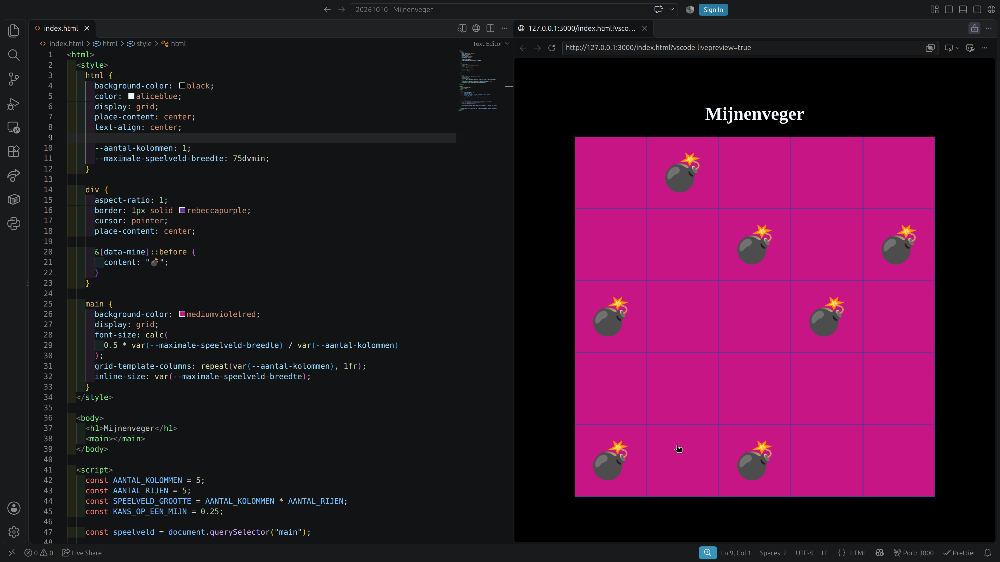

---
categories:
  - Activiteiten
tags:
  - CSS
  - HTML
  - JavaScript
  - Spel
---

# Mijnenveger

In deze activiteit bouwen we [het klassieke spel "Mijnenveger"](<https://nl.wikipedia.org/wiki/Mijnenveger_(spel)>), wat standaard is meegeleverd met Windows sinds 1989, na in HTML, CSS en JavaScript.

!!!tip VS Code
Voor deze activiteit gebruiken we VS Code. Hieronder vind je de snelle handleiding om direct van start te kunnen gaan. Zie [de uitgebreide handleiding](/handleidingen/visual-studio-code.md) voor meer informatie.

- Download het installatiebestand voor VS Code van [de officiële website](https://code.visualstudio.com).
- Open het bestand en volg de stappen om VS Code te installeren.
- Download het "VS Code configuratie" bestand hieronder en pak het uit.

[!file VS Code configuratie](/files/vscode-configuratie.zip)

- Hernoem de uitgepakte map naar _Mijnenveger_.
- Klik met de rechter muisknop op de map en selecteer "Open in VS Code".
- Installeer de aangeraden "extensies".
- Je bent nu klaar om te beginnen.

!!!

## Dojos

### 10 Oktober 2026

Hieronder vind je de status van het spel waar we tijdens de CoderDojo op 12
september 2026 zijn geeindigd.

Als je nog geen eigen versie hebt van het spel van de vorige dojo, kun je de code hieronder kopiëren en in een nieuw `index.html` bestand plakken in de map die je voor het project hebt aangemaakt zoals uitgelegd aan het begin van deze pagina.

```html
<html>
  <style>
    html {
      background-color: black;
      color: aliceblue;
      display: grid;
      place-content: center;
      text-align: center;

      --aantal-kolommen: 1;
      --maximale-speelveld-breedte: 75dvmin;
    }

    div {
      aspect-ratio: 1;
      border: 1px solid rebeccapurple;
      cursor: pointer;
      place-content: center;

      &[data-mine]::before {
        content: "💣";
      }
    }

    main {
      background-color: mediumvioletred;
      display: grid;
      font-size: calc(
        0.5 * var(--maximale-speelveld-breedte) / var(--aantal-kolommen)
      );
      grid-template-columns: repeat(var(--aantal-kolommen), 1fr);
      inline-size: var(--maximale-speelveld-breedte);
    }
  </style>

  <body>
    <h1>Mijnenveger</h1>
    <main></main>
  </body>

  <script>
    const AANTAL_KOLOMMEN = 5;
    const AANTAL_RIJEN = 5;
    const SPEELVELD_GROOTTE = AANTAL_KOLOMMEN * AANTAL_RIJEN;
    const KANS_OP_EEN_MIJN = 0.25;

    const speelveld = document.querySelector("main");

    // Teken alle cellen
    for (let cell_id = 0; cell_id < SPEELVELD_GROOTTE; cell_id++) {
      const cell = document.createElement("div");
      speelveld.appendChild(cell);

      cell.toggleAttribute("data-mine", Math.random() < KANS_OP_EEN_MIJN);
    }

    document.body.style.setProperty("--aantal-kolommen", AANTAL_KOLOMMEN);
  </script>
</html>
```

Open het bestand in VS Code, klik met de rechter muisknop ergens tussen de code en kies voor _Show Preview_. De editor moet er dan ongeveer uitzien zoals hieronder weergegeven.


